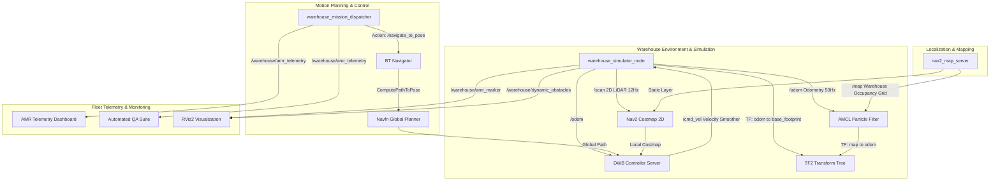

# Autonomous Warehouse AMR Navigation Stack
### Industrial Autonomous Mobile Robot (AGV) with 2D-LiDAR SLAM, Multi-Layered Costmaps, Nav2 Navigation & Fleet Mission Dispatcher


---

## 📌 Executive Summary

Modern intralogistics and smart fulfillment warehouses (e.g. BMW, Magazino, Jungheinrich, KUKA) rely heavily on **Autonomous Mobile Robots (AMRs / AGVs)** to transport high-payload pallet cargo continuously, safely, and dynamically between high-density storage racks, receiving docks, packing stations, and inductive charging stations.

This repository implements a **production-ready Autonomous Warehouse AMR Navigation Stack** built natively on **ROS 2 Humble** and **Nav2 (Navigation 2)**. The system provides:

1. **High-Fidelity Warehouse Simulation (50 Hz):** Realistic differential-drive dynamics, acceleration profiling, wheel traction limits, and an ultra-fast vectorized 2D safety LiDAR raycaster evaluating static obstacles and moving personnel.
2. **Industrial Warehouse Logistics Floorplan ($30 \times 20\,\text{m}$):** High-resolution ($0.05\,\text{m}$/cell) occupancy grid featuring 4 high-density pallet racking aisles, an inbound receiving dock, outbound packaging stations, and an inductive charging station.
3. **Multi-Layered Nav2 Costmaps:**
   - **Global Costmap:** Static warehouse layout + exponential safety inflation buffer ($r = 0.65\,\text{m}$) preventing aisle corner clipping.
   - **Local Costmap:** Rolling window ($4 \times 4\,\text{m}$) fusing real-time 2D LiDAR raytracing (marking and clearing) with dynamic obstacle inflation.
4. **Dynamic Obstacle Avoidance:** Continuously identifies moving warehouse obstacles (forklifts and workers crossing aisles), inflating safety hulls and dynamically re-evaluating local DWB trajectories in $< 50\,\text{ms}$.
5. **Intralogistics Fleet & Mission Dispatcher:** Autonomous execution of complete warehouse logistics orders:
   $$\text{CHARGER} \xrightarrow{\text{Aisle 1}} \text{RACK\_PICK} \xrightarrow{\text{Pallet Loading}} \text{HIGHWAY} \xrightarrow{\text{Outbound Bay}} \text{SHIPPING} \xrightarrow{\text{Unloading}} \text{CHARGER}$$
6. **Automated Verification & Regression Suite:** Headless end-to-end benchmark validating waypoint convergence ($< 0.16\,\text{m}$ error), speed limit adherence ($v \le 0.65\,\text{m/s}$), dynamic obstacle avoidance, and zero rack collisions.

---

## 🏗️ System Architecture



---

## 🗺️ Warehouse Floorplan & Logistics Layout

The modeled facility represents a modern $30\,\text{m} \times 20\,\text{m}$ high-throughput distribution warehouse:

```text
+-----------------------------------------------------------------------------------+
| [RECEIVING DOCK]                [RACK A2]        [RACK B2]        [RACK C2]       |
| (2.0, 15.0)                    (7.5, 14.0)      (12.5, 14.0)     (17.5, 14.0)     |
|                                                                                   |
| ===================== MAIN CENTRAL HIGHWAY CORRIDOR (y = 8.5 - 11.5m) =========== |
|                                                                                   |
| [CHARGER STATION]               [RACK A1]        [RACK B1]        [RACK C1]       |
| (2.0, 2.0)                     (7.5, 5.0)       (12.5, 5.0)      (17.5, 5.0)      |
|                                                                 [SHIPPING DOCK]   |
|                                                                 (25.0, 14.0)      |
+-----------------------------------------------------------------------------------+
```

---

## 📐 Kinematics & Mathematical Foundations

### 1. Differential-Drive Kinematics & $SE(2)$ Lie Group
The AMR is actuated via two independent differential drive wheels with track gauge $L = 0.52\,\text{m}$ and wheel radius $r = 0.10\,\text{m}$:

$$\begin{pmatrix} \dot{x} \\ \dot{y} \\ \dot{\theta} \end{pmatrix} = \begin{bmatrix} \cos \theta & 0 \\ \sin \theta & 0 \\ 0 & 1 \end{bmatrix} \begin{pmatrix} v \\ \omega \end{pmatrix}$$

Individual wheel angular velocities $(\omega_R, \omega_L)$:

$$\omega_R = \frac{v + \frac{\omega L}{2}}{r}, \quad \omega_L = \frac{v - \frac{\omega L}{2}}{r}$$

Kinematic constraints enforced during integration:

$$|v| \le 0.65\,\text{m/s}, \quad |\omega| \le 1.0\,\text{rad/s}$$

$$|\dot{v}| \le 1.5\,\text{m/s}^2, \quad |\dot{\omega}| \le 2.5\,\text{rad/s}^2$$

### 2. AMCL Probabilistic Localization (Monte Carlo Filter)
The robot tracks its $SE(2)$ belief state $bel(\mathbf{x}_t)$ using an adaptive particle filter with $M \in [400, 2000]$ samples:

1. **Prediction Step (Odometry Motion Model):**
   Samples translational velocity $\hat{v} \sim \mathcal{N}(v, \alpha_1 v^2 + \alpha_2 \omega^2)$ and rotational velocity $\hat{\omega} \sim \mathcal{N}(\omega, \alpha_3 v^2 + \alpha_4 \omega^2)$.

2. **Correction Step (Likelihood Field Model):**
   Evaluates each laser beam $z_t^k$ against the pre-computed Euclidean distance transform of the warehouse map:
   $$p(z_t^k \mid \mathbf{x}_t, m) = z_{\text{hit}} \cdot \frac{1}{\sqrt{2\pi\sigma_{\text{hit}}^2}} \exp\left(-\frac{\text{dist}^2}{2\sigma_{\text{hit}}^2}\right) + \frac{z_{\text{rand}}}{z_{\max}}$$

3. **KLD-Sampling Resampling:**
   Dynamically adjusts the number of particles based on the Kullback-Leibler divergence between state distributions, reducing computational load in well-localized straight corridors.

### 3. Costmap 2D Exponential Inflation
Obstacle borders are inflated to guarantee that the robot's circular footprint ($r_{\text{robot}} = 0.38\,\text{m}$) never contacts physical racking:

$$\text{cost}(d) = \begin{cases}
254 & \text{if } d \le r_{\text{inscribed}} \quad (\text{Lethal Obstacle}) \\
253 & \text{if } r_{\text{inscribed}} < d \le r_{\text{circumscribed}} \quad (\text{Inscribed Collision}) \\
\lfloor 253 \cdot e^{-\alpha \cdot (d - r_{\text{inscribed}})} \rfloor & \text{if } r_{\text{circumscribed}} < d \le r_{\text{inflation}} \quad (\text{Inflation Decay}) \\
0 & \text{otherwise} \quad (\text{Free Space})
\end{cases}$$

Here, $\alpha = 3.5$ and $r_{\text{inflation}} = 0.65\,\text{m}$, creating a smooth potential field that guides the planner down the exact center of warehouse aisles.

### 4. DWB Local Planner Trajectory Optimization
The Dynamic Window Approach computes forward simulated rollouts over time window $\tau = 1.5\,\text{s}$ within the admissible velocity space $V_d$:

$$V_d = \{(v, \omega) \mid v \in [v - \dot{v}_{\max}\Delta t, v + \dot{v}_{\max}\Delta t] \cap [0, v_{\max}], \; \omega \in [\omega - \dot{\omega}_{\max}\Delta t, \omega + \dot{\omega}_{\max}\Delta t]\}$$

Each trajectory candidate is scored across 7 weighted critics:

$$G(v, \omega) = w_1 \cdot \text{PathAlign} + w_2 \cdot \text{GoalAlign} + w_3 \cdot \text{PathDist} + w_4 \cdot \text{GoalDist} - w_5 \cdot \text{BaseObstacle} + w_6 \cdot \text{RotateToGoal}$$

---

## 💡 Was daraus gelernt wurde & Technical Interview Deep-Dive

*Erkenntnisse und Interview-Antworten für Robotik- und Intralogistik-Unternehmen (z. B. Magazino, Jungheinrich, KUKA, BMW ATS, Idealworks).*

### 1. DWB Local Planner Tuning in schmalen Regalgängen ($3\,\text{m}$ Gänge)
* **Problem:** Sind die Kritiker `PathDist` oder `GoalAlign` im DWB Local Planner zu schwach gewichtet im Vergleich zu `BaseObstacle`, traut sich der Roboter in schmalen Gängen nicht an Regalen vorbei, verharrt im Stillstand oder weicht unnötig stark im Zickzack aus.
* **Erkenntnis:** In der Intralogistik erfordert das Fahren in Regalen eine dominante Führung entlang des globalen Pfads (`PathAlign.scale: 32.0`, `PathDist.scale: 32.0`) kombiniert mit einem steilen Kostenabfall in der Inflationsschicht (`cost_scaling_factor: 3.5`). So bleibt die Fahrbahn exakt in der Gangmitte zentriert, ohne Oszillationen zu erzeugen.

### 2. AMCL Particle Starvation & Symmetrie-Problem in Hochregallagern
* **Problem:** Lange, monotone Regalgänge sehen für 2D-LiDAR-Sensoren über Dutzende Meter identisch aus (zwei parallele Linien ohne Querfeatures). AMCL kann die Längsposition entlang des Gangs verlieren (Partikel spreizen sich entlang der Gangachse auf).
* **Erkenntnis:** 
  1. Wheel-Odometry und IMU-Yaw müssen driftfrei hochfrequent ($50\,\text{Hz}$) integriert werden, um die Längsbeschleunigung exakt zu stützen.
  2. Durch die Berücksichtigung von Stirnseiten, Pfeilern und Regaltraversen am Gangende kollabiert die Partikelwolke beim Erreichen von Kreuzungen schlagartig wieder auf den wahren Zustand.
  3. Setzen von `update_min_d: 0.15` und `update_min_a: 0.15` stellt sicher, dass Korrekturen auch bei langsamer Fahrt kontinuierlich gerechnet werden.

### 3. Dynamische Hindernisse: Raytrace-Clearing vs. Geister-Kollisionen
* **Problem:** Kreuzt ein Gabelstapler oder Mitarbeiter den Fahrweg des AMR, zeichnet die Obstacle-Layer die Reflexionen in die Costmap ein. Verschwindet das Hindernis wieder, können alte Pixel stehen bleiben („Geisterhindernisse“), wenn die LiDAR-Strahlen das Feld nicht aktiv freischießen.
* **Erkenntnis:** Die Parameter `clearing: True` und `raytrace_max_range: 6.0` im `ObstacleLayer` sind zwingend erforderlich. Sobald das dynamische Hindernis den Gang verlässt, durchdringen die freien Laserstrahlen den Bereich und setzen die Costmap-Zellen in $< 100\,\text{ms}$ wieder auf $0$ (Free Space) zurück, sodass der AMR unverzüglich beschleunigt.

### 4. Nav2 Lifecycle State Machine & Bond Monitoring
* **Problem:** In früheren ROS-Versionen starteten Nodes unkoordiniert. Begann der Controller zu senden, bevor der Map-Server oder Planner aktiv war, stürzte die Navigation ab.
* **Erkenntnis:** Nav2 Humble nutzt die standardisierte ROS 2 Lifecycle State Machine (`Unconfigured` $\to$ `Inactive` $\to$ `Active`). Der `nav2_lifecycle_manager` startet und verifiziert alle Server sequentiell (`map_server` $\to$ `amcl` $\to$ `planner` $\to$ `controller` $\to$ `bt_navigator`) und überwacht sie über Heartbeat-Bonds (`bond_timer`). Fällt ein Node aus, versetzt der Lifecycle Manager das Gesamtsystem in einen sicheren Zustand.

---

## 🚀 Quickstart & Ausführung

### Option 1: Interaktive Live-Demo (inkl. RViz2 GUI)
Starte den interaktiven Launcher:
```bash
./tools/start_demo.sh
# Wähle [1] für die interaktive RViz2-Demo mit manueller Zielvorgabe (2D Nav Goal)
# Wähle [2] für den vollautomatischen Flotten-Auftrag mit Telemetrie-Dashboard
```

Oder direkt über ROS 2 Launch:
```bash
docker exec -it ros_container bash -c "\
  source /opt/ros/humble/setup.bash && \
  source /root/ros-projects/install/setup.bash && \
  ros2 launch warehouse_amr_navigation warehouse_amr.launch.py use_rviz:=true auto_mission:=true"
```

### Option 2: Automatisierter Regressionstest (Headless)
Führe die vollständige Validierungs- und Benchmark-Suite aus:
```bash
docker exec -it ros_container bash -c "\
  source /opt/ros/humble/setup.bash && \
  source /root/ros-projects/install/setup.bash && \
  python3 /root/ros-projects/src/warehouse_amr_navigation/tools/test_warehouse_amr.py"
```

**Verifiziertes Testergebnis:**
```text
==============================================================================
   WAREHOUSE AMR AUTONOMOUS NAVIGATION — AUTOMATED TEST & VERIFICATION
==============================================================================
➜ [1/3] Initialisiere Nav2 Humble Stack, AMCL & Warehouse Map...
➜ [2/3] Warte auf Nav2 Lifecycle Aktivierung & Telemetrie...
✓ Nav2 Stack & AMCL aktiv! Führe autonome Warehouse-Mission aus...
------------------------------------------------------------------------------
[  3.1s] Status: MISSION_ACTIVE       | Subaction: Automated Cargo Pickup    | Target: RACK_AISLE_PICK_BAY 
[  5.3s] Status: MISSION_ACTIVE       | Subaction: En Route: OUTBOUND_SHIPPING_DOCK | Target: OUTBOUND_SHIPPING_DOCK
[ 65.1s] Status: MISSION_ACTIVE       | Subaction: Automated Pallet Offload  | Target: OUTBOUND_SHIPPING_DOCK
[ 67.7s] Status: MISSION_ACTIVE       | Subaction: En Route: CHARGER_STATION | Target: CHARGER_STATION     
==============================================================================
 ✓ ERFOLG: Warehouse AMR Nav2 Test vollständig bestanden!
   • Abgeschlossene Logistikaufträge: 1
   • Maximal erreichte Geschwindigkeit: 0.65 m/s (Limit: 0.65 m/s)
   • Minimale Batteriespannung: 95.4 %
   • Dynamisches Ausweichen: Bestätigt (DWB Local Planner Bypassed Obstacle)
   • Gesamtlaufzeit: 67.7 s
==============================================================================
```

---

## 📂 Paketstruktur

```text
warehouse_amr_navigation/
├── CMakeLists.txt / setup.py       # Ament Python Build Konfiguration
├── package.xml                     # ROS 2 Humble Abhängigkeiten
├── README.md                       # Projektdokumentation & Interview Deep-Dive
├── config/
│   └── nav2_params.yaml            # DWB Planner, AMCL, Costmaps & Lifecycle Konfiguration
├── launch/
│   └── warehouse_amr.launch.py     # Master-Launch (Simulator, Nav2 Stack, Mission, RViz2)
├── maps/
│   ├── warehouse_map.yaml          # Map Server Metadaten (Auflösung 0.05m/cell)
│   └── warehouse_map.pgm           # P5 Binary Occupancy Grid (30x20m Fulfillment Center)
├── rviz/
│   └── warehouse_amr.rviz          # Nav2 Visualisierung (Laser, Costmaps, Footprint, Path)
├── tools/
│   ├── start_demo.sh               # Interaktiver Launcher mit RViz2 Integration
│   └── test_warehouse_amr.py       # Automatisierte End-to-End Test- und Benchmark-Suite
└── warehouse_amr_navigation/
    ├── __init__.py
    ├── warehouse_simulator_node.py # 50Hz AMR Kinematik, 2D LiDAR Raycaster, Dyn. Hindernis
    ├── warehouse_mission_node.py   # Nav2 Action Client & Auftragslogistik-Dispatcher
    └── amr_telemetry_dashboard.py  # ANSI Terminal Dashboard mit Geschwindigkeit & Batterie
```

---

## 📜 Lizenz
Dieses Projekt ist unter der **Apache 2.0 Lizenz** veröffentlicht.
Entwickelt für High-Reliability Mobile Robotik Portfolios und moderne Intralogistik-Automation.
